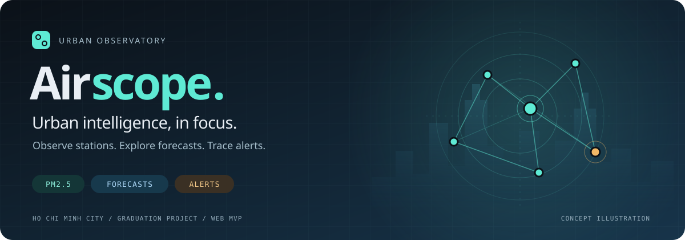
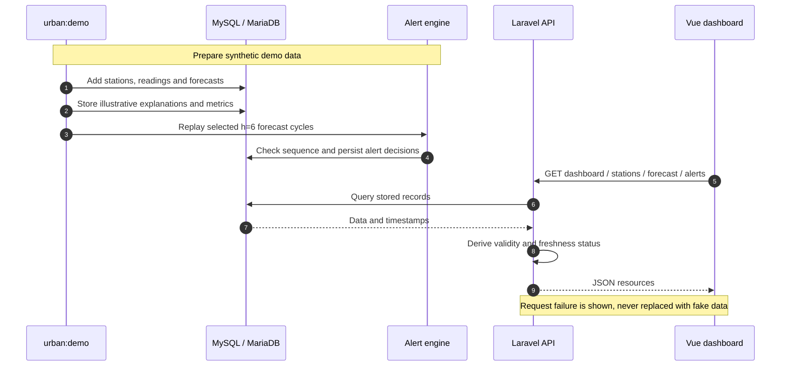

<p align="center">
  
</p>

<h1 align="center">Airscope · Urban PM2.5 Observatory</h1>

<div align="center">

**Quan sát đô thị. Theo dõi dự báo. Hiểu từng cảnh báo.**

Laravel 12 API · Vue 3 dashboard · MySQL-compatible data layer · Flood-detection extension

[](https://laravel.com/)
[](https://vuejs.org/)
[](https://www.php.net/)
[](https://nodejs.org/)
[](#project-scope)

[Tổng quan](#overview) · [Kiến trúc](#architecture) · [Luồng xử lý](#data-flow) · [Cài đặt](#local-development) · [Tài liệu](#documentation)

</div>

Đồ án **"Tích hợp AI trong quản lý đô thị"**: dashboard theo dõi PM2.5 tại TP.HCM, dự báo theo trạm và lịch sử cảnh báo có thể truy vết. Repo gồm web Laravel/Vue cùng module Python thử nghiệm nhận diện ngập từ ảnh.

> [!IMPORTANT]
> **Dữ liệu PM2.5, dự báo, giải thích và chỉ số mô hình đi kèm đều là dữ liệu demo tổng hợp.** Đây chưa phải kết quả huấn luyện thực tế, hướng dẫn sức khỏe hay bản đồ ô nhiễm toàn thành phố. Banner là hình minh họa, không phải ảnh chụp dashboard hoặc dữ liệu đo.

<a id="overview"></a>

## Một góc nhìn, nhiều lớp thông tin

| Quan sát | Khám phá | Truy vết |
| :--- | :--- | :--- |
| Bản đồ trạm và điểm nóng | Dự báo **1 / 6 / 24 giờ** | Lịch sử mở / đóng cảnh báo |
| PM2.5 và trạng thái dữ liệu | Biểu đồ và chi tiết từng trạm | Lý do ra quyết định theo quy tắc |
| Độ mới và mức độ sẵn có | Giải thích và metrics **minh họa** | Nhật ký pipeline và lỗi API |

<a id="architecture"></a>

## Kiến trúc hệ thống

**Web PM2.5 hiện tại** đọc dữ liệu từ database; lệnh `urban:demo` tạo bộ dữ liệu minh họa. **Flood Detection** là phần mở rộng độc lập, chưa nối tự động vào dashboard.

```mermaid
flowchart TB
    subgraph PM["01 / PM2.5 WEB MVP"]
        direction LR
        DEMO["urban:demo<br/>Synthetic records"] --> DB[("MySQL / MariaDB")]
        DEMO --> ENGINE["Alert engine<br/>h = 6 / two-cycle policy"]
        ENGINE --> DB
        DB --> API["Laravel 12<br/>Read API: /api/*"]
        API --> UI["Vue 3 + Leaflet<br/>Dashboard / map / forecasts"]
    end

    subgraph FLOOD["02 / FLOOD DETECTION EXTENSION"]
        direction LR
        FRAME["Image upload"] --> WORKER["FastAPI /predict<br/>Requires trained artifact"]
        WORKER --> RESULT["Label + probabilities"]
        RESULT -. "Caller integration required" .-> FAPI["Laravel /api/v1/flood<br/>Token-protected records"]
        FAPI --> FDB[("Flood tables")]
    end

    classDef app fill:#123032,stroke:#5eead4,color:#e9eef4
    classDef data fill:#17344a,stroke:#75b9f3,color:#e9eef4
    classDef extension fill:#332615,stroke:#f2b866,color:#fff1dc
    class DEMO,ENGINE,API,UI app
    class DB,FDB data
    class FRAME,WORKER,RESULT,FAPI extension
```



Đường liền thể hiện các bước đã có mã xử lý; đường nét đứt là phần kết nối cần bổ sung. Các bảng PM2.5 và flood dùng cùng database của Laravel. `/predict` trả kết quả cho caller, không tự gửi sang Laravel; chưa có worker đọc camera liên tục hay tự tạo flood alert.

## Chạy nhanh trên máy này

Mở PowerShell tại `D:\DoAnTotNghiep\web` (dependencies và `.env` đã được chuẩn bị):

```powershell
powershell -NoProfile -File scripts/local-db.ps1 start
php artisan migrate
php artisan urban:demo
npm run build
php artisan serve --host=127.0.0.1 --port=8000
```

Mở `http://127.0.0.1:8000`. Nhấn Ctrl+C để dừng web. Dừng DB riêng bằng `powershell -NoProfile -File scripts/local-db.ps1 stop`.

Ứng dụng có tổng quan, bản đồ trạm, dự báo 1/6/24 giờ, chi tiết dữ liệu và giải thích, lịch sử cảnh báo có bộ lọc/phân trang, chỉ số mô hình và nhật ký pipeline. Các trang đều đọc API Laravel; mất kết nối có thông báo rõ ràng, không tự thay bằng số liệu giả trong frontend.

<a id="project-scope"></a>

### Phạm vi hiện tại

Phạm vi bàn giao là **web MVP**. Dữ liệu TP.HCM được tạo để demo, chưa nối OpenAQ/Open-Meteo, chưa huấn luyện XGBoost/Persistence hoặc tính SHAP thật. Bronze/Silver/Gold hiện chỉ là số liệu minh họa từ DB, chưa có kho Parquet hay pipeline Python cho PM2.5. Ngưỡng `35` và cooldown `6` giờ là cấu hình demo, không phải P90 đã tính từ train hoặc chuẩn sức khỏe. Chưa có đăng nhập, phân quyền, email/SMS hoặc triển khai Internet.

Phần bổ sung Flood Detection nằm độc lập trong `ml/flood_detection`: baseline CPU-friendly, preprocessing/split Stage 2 và FastAPI inference worker. Laravel thêm schema/API `/api/v1/flood`; prediction được lưu idempotent nhưng chưa tự mở alert theo từng frame. Cần cung cấp dataset có license rõ ràng và đặt `FLOOD_API_TOKEN` trước khi dùng ngoài máy local.

<a id="data-flow"></a>

## Từ dữ liệu demo đến dashboard

Luồng dưới đây mô tả cách bộ demo hiện tại được nạp và đọc. API PM2.5 chỉ cung cấp các route đọc; không có endpoint nhận dữ liệu cảm biến trực tiếp.



<details>
<summary><strong>Quy tắc cảnh báo PM2.5 · h = 6</strong></summary>

| Bằng chứng | Kết quả |
| :--- | :--- |
| Hai chu kỳ liên tiếp hợp lệ cùng vượt ngưỡng, dữ liệu mới nhất còn mới | Mở sự kiện nếu chưa mở |
| Hai chu kỳ liên tiếp hợp lệ cùng không vượt ngưỡng, dữ liệu mới nhất còn mới | Đóng sự kiện đang mở |
| Thiếu, lỗi, stale hoặc không đủ chuỗi liên tiếp | Không tự đóng sự kiện đang mở; có thể ghi trạng thái unknown |
| Bản dự báo trùng hoặc đến sai thứ tự | Không xử lý lại quyết định |

Cooldown giới hạn việc ghi nhận nhắc lại, không chặn việc mở một đợt sự kiện mới. Chưa gửi email/SMS thực tế. Xem [`UrbanAlertEngine`](app/Services/UrbanAlertEngine.php).

</details>

## Local development

Requirements: PHP 8.2+, Composer, Node.js 20+, and MySQL/MariaDB.

```powershell
composer install
if (-not (Test-Path .env)) { Copy-Item .env.example .env }
php artisan key:generate
# Set DB_DATABASE, DB_USERNAME, DB_PASSWORD and DB_HOST in .env
php artisan migrate
php artisan urban:demo
npm install
npm run build
php artisan serve
```

Open `http://127.0.0.1:8000`. For hot reload, run `npm run dev` in a second terminal while `php artisan serve` stays running. The build creates the Vue bundle in `public/build`.

On this Windows workstation, a separate local MariaDB instance is available on port `3307` through `scripts/local-db.ps1`. It uses the MySQL protocol and the Laravel MySQL driver, and stores data only in `web/storage/local-mysql` (not XAMPP's existing data directory).

```powershell
powershell -NoProfile -File scripts/local-db.ps1 start
php artisan urban:demo
php artisan serve --host=127.0.0.1 --port=8000
```

The existing local `.env` (not committed) uses `DB_CONNECTION=mysql`, `DB_HOST=127.0.0.1`, `DB_PORT=3307`, `DB_DATABASE=urban_observatory`, `DB_USERNAME=urban`, `DB_PASSWORD=urban`. These are disposable local defaults, not production credentials. The helper requires XAMPP's MariaDB binaries at `C:\xampp\mysql\bin`; other machines can use their own MySQL server. Use `scripts/local-db.ps1 stop` to stop only that isolated database instance.

Demo observations, forecasts and events are additive and idempotent; the synthetic model-metric snapshot is refreshed in place so a new install also shows its optional station-error breakdown. Run `php artisan urban:demo` before a demo session to add a recent snapshot; repeat calls within the same hour do not duplicate it. Forecasts naturally become stale after the configured freshness window. Never reset or truncate an existing database just to refresh the dashboard.

## Docker / MySQL

1. Create `.env` from `.env.example` only if absent, and set `APP_KEY`, `DB_PASSWORD`, and `DB_ROOT_PASSWORD`. Keep the existing key when data is already in use. If PHP is available locally, `php artisan key:generate` creates the key; otherwise build the image and run `docker compose run --rm --no-deps app php artisan key:generate --show`, then put the result in `.env`.
2. Build and start the private MySQL network:

```powershell
docker compose up --build -d
docker compose exec app php artisan migrate --force
docker compose exec app php artisan urban:demo
```

The app is exposed on `http://127.0.0.1:8080`; MySQL is intentionally not published to the host.

Docker uses MySQL 8.4; local checks on this workstation use MariaDB 10.4 through Laravel's MySQL driver. Docker image execution has not been verified here because Docker CLI is unavailable. This unauthenticated prototype is bound to loopback; add access control, TLS, backups and secret management before any shared deployment.

## API

Read-only endpoints are available under `/api`: `/health`, `/dashboard`, `/stations`, `/stations/{id}`, `/forecast`, `/hotspots`, `/alerts`, `/model/metrics`, and `/pipeline/status`. The complete response contract is in [`docs/API.md`](docs/API.md).

The alert engine uses the report's h=6 policy: two consecutive valid forecasts above the internal threshold open an event; two consecutive valid forecasts at or below it close the event. Missing, invalid, stale, and out-of-order data do not create evidence. Forecast identity is immutable and idempotent.

## Checks

Kiểm tra local gần nhất **04/10/2026**: **30 PHP tests / 151 assertions**, **10 frontend tests**, production build thành công. Đây là kết quả chạy local, không phải badge CI tự cập nhật.

```powershell
php artisan test --compact
npm run test:frontend
npm run build
powershell -NoProfile -File scripts/local-db.ps1 start
powershell -NoProfile -File scripts/http-smoke.ps1
```

PHP tests use an isolated in-memory SQLite database, never the developer's MySQL data. HTTP smoke checks exercise the configured MySQL driver. No browser interaction/visual test suite is bundled.

<a id="documentation"></a>

## Tài liệu & mã nguồn

| Tài liệu | Nội dung |
| :--- | :--- |
| [API contract](docs/API.md) | Endpoints, response và trạng thái dữ liệu |
| [Backend foundation](docs/backend-db-foundation-report.md) | Database, API và kiểm thử backend |
| [Flood baseline](docs/flood-detection-baseline-report.md) | Dataset, feature extraction, training và giới hạn |
| [ML setup](ml/README.md) | Chuẩn bị môi trường Python và chạy module |

```text
app/                 Laravel controllers, models and services
database/            Migrations and synthetic demo seeder
resources/js/        Vue dashboard, station map and forecast chart
resources/css/       Dashboard design system
ml/flood_detection/  Dataset preparation, baseline and inference
tests/               PHP and frontend tests
docs/                API contract, reports and README artwork
```

<div align="center">

**Airscope** · Graduation project · Ho Chi Minh City

</div>
